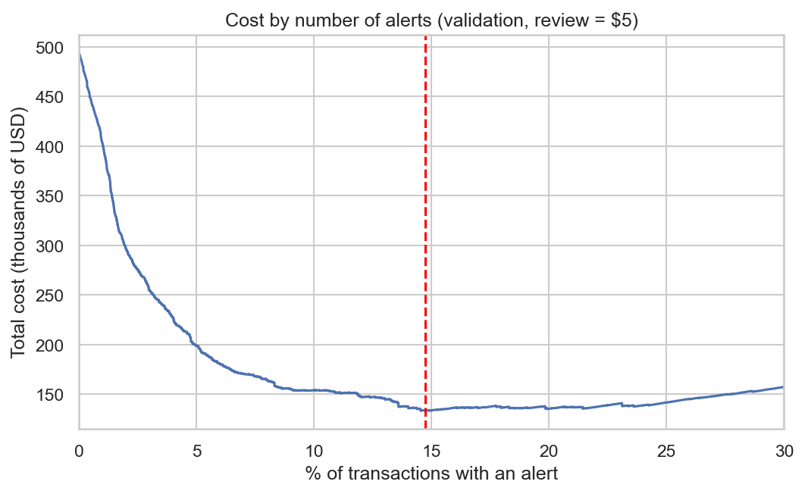
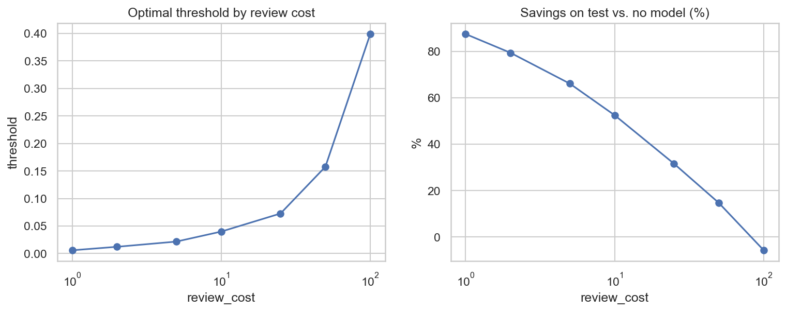
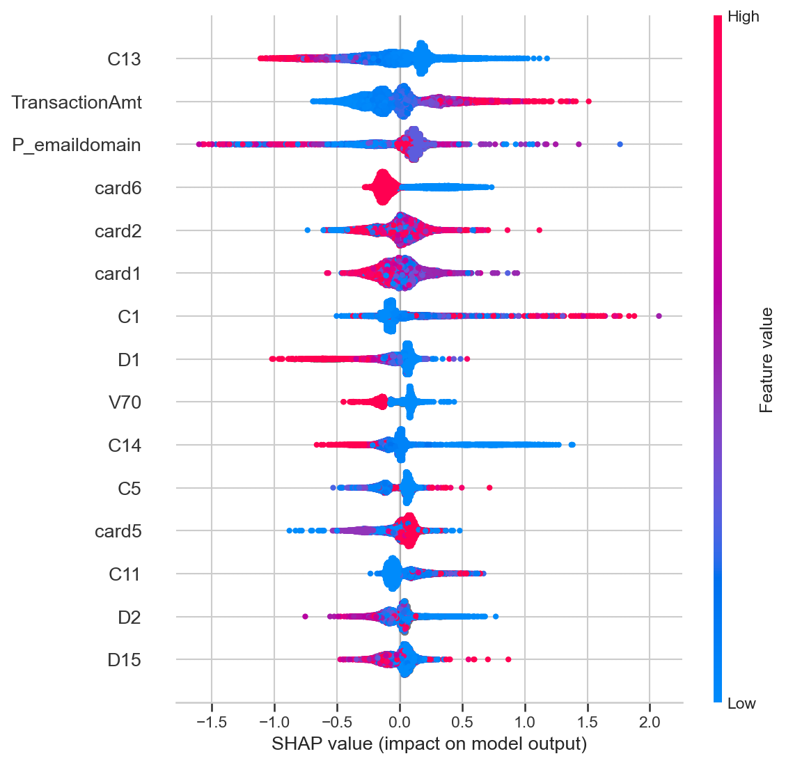

🇬🇧 [Read in English](README.md)
# Detección de fraude en transacciones (IEEE-CIS)

Proyecto de detección de fraude con datos reales de e-commerce, enfocado en **validación temporal**, **medición rigurosa** (varias semillas, resultados negativos incluidos) y **traducción de la métrica a costo de negocio**. Este proyecto fue realizado con asistencia de LLMs.

**Autor:** Carlos Adolfo Peralta · [LinkedIn](https://www.linkedin.com/in/carlosperalta1993/) · [GitHub](https://github.com/CarlosAdolfoPeralta)

## Resumen

| | |
|---|---|
| **Problema** | Clasificar transacciones como fraudulentas o legítimas, con un 3,5% de fraude |
| **Datos** | [IEEE-CIS Fraud Detection](https://www.kaggle.com/competitions/ieee-fraud-detection) (Vesta): 590.540 transacciones, 435 columnas, ~180 días |
| **Modelo final** | LightGBM sin ajuste de desbalance, variables originales |
| **Resultado en test** | AUC-PR 0,544 (15,7x la tasa base) · AUC-ROC 0,906 |
| **Impacto (supuesto: revisión = 5 USD)** | 66% menos costo que no tener modelo (168 mil vs 495 mil USD) |

## Decisiones principales

1. **Validación temporal, no aleatoria.** División por tiempo: train (días 1-119), validación (120-149) y test (150-182). Los cortes se eligieron para no partir un pico de fraude. El test se usó una sola vez, al final.
2. **Métricas para clases desbalanceadas.** AUC-PR como métrica principal, junto con AUC-ROC y recall a precisión fija. La accuracy no se usa.
3. **Comparaciones con 3 semillas.** Una sola corrida mostró una "mejora" de +0,008 en AUC-PR que desapareció al promediar semillas. Todas las comparaciones reportan media ± desviación.
4. **Umbral por costo, no por 0,5.** El umbral de decisión se elige minimizando el costo esperado en validación.

## Resultados

### Baseline y experimentos (validación, media ± desviación de 3 semillas)

| Configuración | AUC-PR | AUC-ROC | Recall @ prec. 50% |
|---|---|---|---|
| **Baseline (variables crudas, sin ajuste)** | **0,6172 ± 0,0040** | **0,9276 ± 0,0004** | **0,6215 ± 0,0049** |
| + feature engineering | 0,6167 ± 0,0019 | 0,9282 ± 0,0001 | 0,6133 ± 0,0066 |
| `scale_pos_weight` = sqrt(razón) | 0,5936 ± 0,0014 | 0,9249 ± 0,0007 | 0,5869 ± 0,0037 |
| Submuestreo (20% de negativos) | 0,5960 ± 0,0070 | 0,9267 ± 0,0020 | 0,5885 ± 0,0040 |
| `scale_pos_weight` = razón | 0,2920 ± 0,0132 | 0,8391 ± 0,0029 | 0,2305 ± 0,0200 |

**Dos resultados negativos, documentados a propósito:**
- **El feature engineering no mejoró el modelo.** Se probaron variables causales de comportamiento por cliente (cantidad de transacciones previas, tiempo desde la anterior, monto relativo al histórico, velocidad en 1 h y 24 h), tiempo, monto y email. La diferencia está dentro de la variación entre semillas. Hipótesis (no verificada): el dataset ya incluye variables de comportamiento (columnas `C` y `D`), por lo que las nuestras son redundantes.
- **Ajustar por desbalance empeoró el modelo.** Ponderar o submuestrear bajó el AUC-PR en ~0,02. Con la ponderación completa, el early stopping detuvo el entrenamiento en la primera iteración. No se usó SMOTE por la cantidad de nulos y de variables categóricas.

### Rendimiento final en test

| Métrica | Valor |
|---|---|
| AUC-PR | 0,5441 |
| AUC-ROC | 0,9062 |
| Recall @ precisión 50% | 0,5168 |
| Recall @ precisión 80% | 0,3525 |

Es inferior a validación (AUC-PR 0,617). Causa probable: drift temporal (test es el tramo más lejano de train; cambia la composición de `ProductCD` y de la cobertura de identidad) y algo de optimismo en validación, que se usó para el early stopping y para elegir el umbral. Ambas son hipótesis no verificadas.

### Costo de negocio (test, umbral elegido en validación)

Supuestos: cada alerta se revisa a un costo fijo, la revisión detecta el fraude sin errores y un fraude no alertado cuesta el monto completo de la transacción.

| Estrategia (revisión = 5 USD) | % alertas | Precisión | Recall | Costo (USD) | Ahorro vs. sin modelo |
|---|---|---|---|---|---|
| Sin modelo | 0 | - | 0 | 495.244 | - |
| Revisar todo | 100 | 3,5% | 100% | 473.180 | 4,5% |
| Umbral 0,5 | 1,4 | 81,9% | 33,8% | 390.277 | 21,2% |
| **Umbral por costo (0,0217)** | **15,7** | **17,7%** | **80,1%** | **167.985** | **66,1%** |



**Sensibilidad al costo de revisión** (umbral elegido en validación, medido en test):

| Costo de revisión (USD) | 1 | 2 | 5 | 10 | 25 | 50 | 100 |
|---|---|---|---|---|---|---|---|
| % alertas | 44,3 | 25,1 | 15,7 | 9,4 | 5,8 | 3,1 | 1,7 |
| Recall (%) | 93,9 | 87,3 | 80,1 | 71,0 | 61,5 | 49,6 | 37,2 |
| Ahorro vs. sin modelo (%) | 87,5 | 79,4 | 66,1 | 52,5 | 31,6 | 14,7 | -5,7 |

El valor del modelo depende mucho del costo de revisión. Con 100 USD por revisión el ahorro es negativo: el umbral de validación no transfirió bien a test.



### Interpretabilidad (SHAP)

Entre las variables más influyentes figuran `P_emaildomain` (tercera), `C13`, `TransactionAmt` y `card6`; `C1` también aparece en el top 20. Montos altos empujan hacia fraude y valores altos de `C13` hacia no fraude. En `card6`, el crédito empuja hacia fraude y el débito hacia no fraude, lo que coincide con las tasas observadas (6,7% frente a 2,4%).

Solo 2 de las 20 variables más importantes están enmascaradas, pero las variables enmascaradas (`V*`, `id_*`) suman el 38,7% del peso total, lo que limita la interpretabilidad: se puede decir cuánto pesan, no qué representan. SHAP describe qué usa el modelo, no qué causa el fraude.



## Hallazgos del análisis exploratorio

- **Desbalance:** 3,50% de fraude (20.663 casos).
- **Nulos:** 214 de 435 columnas tienen más de 50% de nulos; las de identidad (`id_*`) son las más vacías.
- **`ProductCD`:** la categoría C tiene 11,7% de fraude y W solo 2,0%.
- **Identidad:** solo ~24% de las transacciones tiene datos de identidad, pero su tasa de fraude es 7,85% contra 2,09% sin identidad. Es una señal, no una causa: probablemente refleja flujos de compra distintos.
- **Drift:** entre train y test cambia la composición de `ProductCD` y la cobertura de identidad (26,6% en train, 17,7% en validación, 20,9% en test).

## Limitaciones

- **Supuestos de costo propios:** la revisión fija y perfecta y la pérdida igual al monto son hipótesis. No se modelan contracargos, multas, fricción con clientes ni daño reputacional.
- **Un único corte temporal:** sin reentrenamiento ni monitoreo del drift.
- **Modelo final entrenado solo con train** (no se reentrenó con validación) y con una sola semilla en test.
- **Hiperparámetros sin tuning.**
- **Variables enmascaradas:** limitan la interpretabilidad.
- **Heurística de `D1`:** el identificador aproximado de cliente usó `day - D1`, una hipótesis de la comunidad de la competencia que no está documentada oficialmente.

## Próximos pasos

- Tuning de hiperparámetros con validación temporal.
- Calibración de probabilidades.
- Reentrenar con train + validación para el modelo final.
- Probar feature engineering sobre las columnas `V`.
- Evaluar con ventanas temporales deslizantes (walk-forward).

## Estructura del repositorio

```
project_fraud_detection_ieee/
├── notebooks/
│   ├── 01_eda.ipynb
│   ├── 02_temporal_validation.ipynb
│   ├── 03_baseline.ipynb
│   ├── 04_feature_engineering.ipynb
│   ├── 05_imbalance_modeling.ipynb
│   └── 06_business_cost_shap.ipynb
├── src/
│   ├── data.py           # carga, merge y reducción de memoria
│   ├── validation.py     # división temporal
│   ├── features.py       # variables causales (experimento descartado)
│   └── evaluate.py       # métricas y costo de negocio
├── reports/figures/
├── requirements.txt
└── README.md
```

## Cómo reproducirlo

1. Instalar dependencias: `pip install -r requirements.txt`
2. Descargar `train_transaction.csv` y `train_identity.csv` desde [Kaggle](https://www.kaggle.com/competitions/ieee-fraud-detection) (hay que aceptar las reglas de la competencia) y copiarlos en `data/raw/` (crear si la carpeta no existe).
3. Ejecutar los notebooks en orden. El `01_eda` genera `data/processed/train_merged.parquet`, que usan los siguientes.

Los datos no se incluyen en el repositorio.

## Tecnologías

Python · pandas · LightGBM · scikit-learn · SHAP · matplotlib / seaborn
