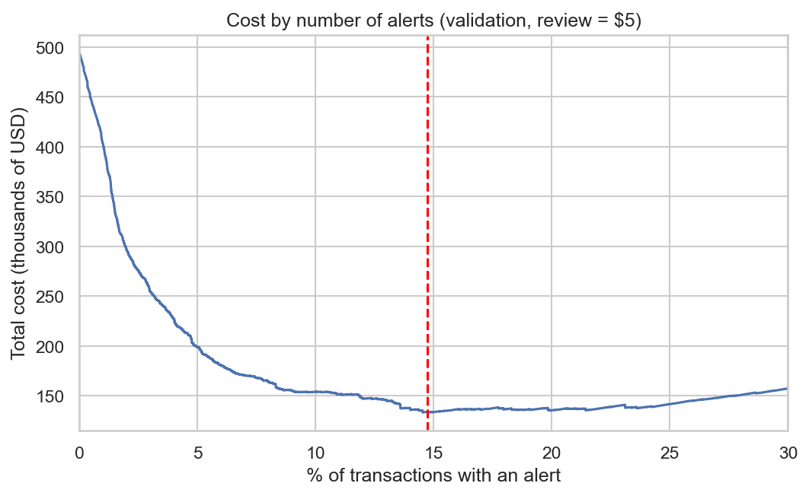
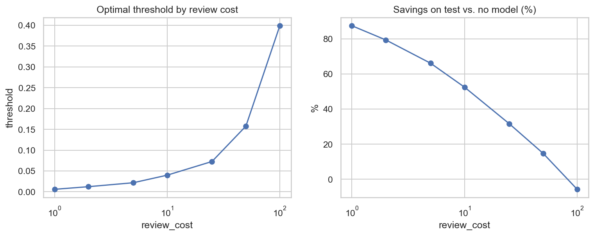
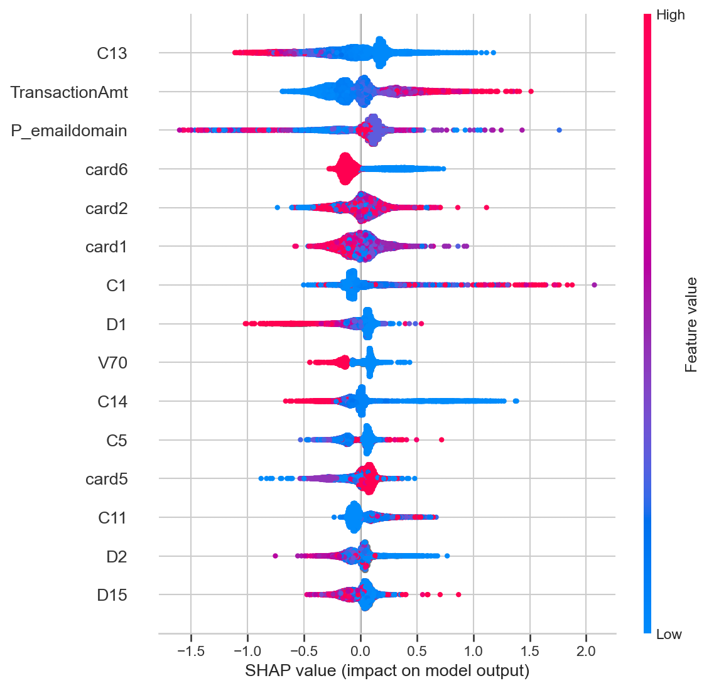

🇪🇸 [Leer en español](README.es.md)

# Transaction Fraud Detection (IEEE-CIS)

A fraud detection project using real e-commerce data, focused on **temporal validation**, **rigorous measurement** (multiple seeds, negative results included) and **translating the metric into business cost**. This project was built with LLM assistance.

**Author:** Carlos Adolfo Peralta · [LinkedIn](https://www.linkedin.com/in/carlosperalta1993/) · [GitHub](https://github.com/CarlosAdolfoPeralta)

## Summary

| | |
|---|---|
| **Problem** | Classify transactions as fraudulent or legitimate, with a 3.5% fraud rate |
| **Data** | [IEEE-CIS Fraud Detection](https://www.kaggle.com/competitions/ieee-fraud-detection) (Vesta): 590,540 transactions, 435 columns, ~180 days |
| **Final model** | LightGBM with no imbalance adjustment, original features |
| **Test result** | AUC-PR 0.544 (15.7x the base rate) · AUC-ROC 0.906 |
| **Impact (assumption: review = USD 5)** | 66% lower cost than having no model (USD 168K vs. USD 495K) |

## Key decisions

1. **Temporal validation, not random.** Time-based split: train (days 1-119), validation (120-149) and test (150-182). The cut points were chosen so as not to split a fraud spike. The test set was used only once, at the end.
2. **Metrics for imbalanced classes.** AUC-PR as the main metric, alongside AUC-ROC and recall at fixed precision. Accuracy is not used.
3. **Comparisons with 3 seeds.** A single run showed an "improvement" of +0.008 in AUC-PR that disappeared when averaging across seeds. All comparisons report mean ± standard deviation.
4. **Cost-based threshold, not 0.5.** The decision threshold is chosen by minimizing the expected cost on validation.

## Results

### Baseline and experiments (validation, mean ± standard deviation over 3 seeds)

| Configuration | AUC-PR | AUC-ROC | Recall @ prec. 50% |
|---|---|---|---|
| **Baseline (raw features, no adjustment)** | **0.6172 ± 0.0040** | **0.9276 ± 0.0004** | **0.6215 ± 0.0049** |
| + feature engineering | 0.6167 ± 0.0019 | 0.9282 ± 0.0001 | 0.6133 ± 0.0066 |
| `scale_pos_weight` = sqrt(ratio) | 0.5936 ± 0.0014 | 0.9249 ± 0.0007 | 0.5869 ± 0.0037 |
| Undersampling (20% of negatives) | 0.5960 ± 0.0070 | 0.9267 ± 0.0020 | 0.5885 ± 0.0040 |
| `scale_pos_weight` = ratio | 0.2920 ± 0.0132 | 0.8391 ± 0.0029 | 0.2305 ± 0.0200 |

**Two negative results, documented on purpose:**
- **Feature engineering did not improve the model.** I tried causal per-customer behavior features (number of previous transactions, time since the last one, amount relative to history, velocity over 1 h and 24 h), plus time, amount and email features. The difference is within the seed-to-seed variation. Hypothesis (not verified): the dataset already includes behavioral features (columns `C` and `D`), so mine are redundant.
- **Adjusting for imbalance made the model worse.** Weighting or undersampling lowered AUC-PR by ~0.02. With full weighting, early stopping halted training at the first iteration. SMOTE was not used because of the number of nulls and categorical variables.

### Final test performance

| Metric | Value |
|---|---|
| AUC-PR | 0.5441 |
| AUC-ROC | 0.9062 |
| Recall @ precision 50% | 0.5168 |
| Recall @ precision 80% | 0.3525 |

This is lower than validation (AUC-PR 0.617). Probable cause: temporal drift (the test set is the furthest segment from train; the mix of `ProductCD` and the identity coverage change) and some optimism in validation, which was used for early stopping and for choosing the threshold. Both are unverified hypotheses.

### Business cost (test, threshold chosen on validation)

Assumptions: each alert is reviewed at a fixed cost, the review detects fraud without errors, and an unflagged fraud costs the full transaction amount.

| Strategy (review = USD 5) | % alerts | Precision | Recall | Cost (USD) | Savings vs. no model |
|---|---|---|---|---|---|
| No model | 0 | - | 0 | 495,244 | - |
| Review everything | 100 | 3.5% | 100% | 473,180 | 4.5% |
| Threshold 0.5 | 1.4 | 81.9% | 33.8% | 390,277 | 21.2% |
| **Cost-based threshold (0.0217)** | **15.7** | **17.7%** | **80.1%** | **167,985** | **66.1%** |



**Sensitivity to review cost** (threshold chosen on validation, measured on test):

| Review cost (USD) | 1 | 2 | 5 | 10 | 25 | 50 | 100 |
|---|---|---|---|---|---|---|---|
| % alerts | 44.3 | 25.1 | 15.7 | 9.4 | 5.8 | 3.1 | 1.7 |
| Recall (%) | 93.9 | 87.3 | 80.1 | 71.0 | 61.5 | 49.6 | 37.2 |
| Savings vs. no model (%) | 87.5 | 79.4 | 66.1 | 52.5 | 31.6 | 14.7 | -5.7 |

The model's value depends heavily on the review cost. At USD 100 per review the savings are negative: the validation threshold did not transfer well to test.



### Interpretability (SHAP)

Among the most influential features are `P_emaildomain` (third), `C13`, `TransactionAmt` and `card6`; `C1` also appears in the top 20. High amounts push toward fraud, and high values of `C13` push toward non-fraud. For `card6`, credit pushes toward fraud and debit toward non-fraud, which matches the observed rates (6.7% vs. 2.4%).

Only 2 of the 20 most important features are masked, but the masked features (`V*`, `id_*`) account for 38.7% of the total weight, which limits interpretability: we can say how much they weigh, not what they represent. SHAP describes what the model uses, not what causes fraud.



## Exploratory analysis findings

- **Imbalance:** 3.50% fraud (20,663 cases).
- **Nulls:** 214 of 435 columns have more than 50% nulls; the identity columns (`id_*`) are the emptiest.
- **`ProductCD`:** category C has 11.7% fraud and W only 2.0%.
- **Identity:** only ~24% of transactions have identity data, but their fraud rate is 7.85% vs. 2.09% without identity. This is a signal, not a cause: it probably reflects different purchase flows.
- **Drift:** between train and test, the mix of `ProductCD` and the identity coverage change (26.6% in train, 17.7% in validation, 20.9% in test).

## Limitations

- **Self-defined cost assumptions:** a fixed, perfect review and a loss equal to the transaction amount are hypotheses. Chargebacks, fines, customer friction and reputational damage are not modeled.
- **A single temporal split:** no retraining or drift monitoring.
- **Final model trained on train only** (not retrained with validation) and with a single seed on test.
- **No hyperparameter tuning.**
- **Masked features:** they limit interpretability.
- **`D1` heuristic:** the approximate customer identifier used `day - D1`, a hypothesis from the competition community that is not officially documented.

## Next steps

- Hyperparameter tuning with temporal validation.
- Probability calibration.
- Retrain on train + validation for the final model.
- Try feature engineering on the `V` columns.
- Evaluate with rolling time windows (walk-forward).

## Repository structure

```
project_fraud_detection_ieee/
├── notebooks/
│   ├── 01_eda.ipynb
│   ├── 02_temporal_validation.ipynb
│   ├── 03_baseline.ipynb
│   ├── 04_feature_engineering.ipynb
│   ├── 05_imbalance_modeling.ipynb
│   └── 06_business_cost_shap.ipynb
├── src/
│   ├── data.py           # loading, merging and memory reduction
│   ├── validation.py     # temporal split
│   ├── features.py       # causal features (discarded experiment)
│   └── evaluate.py       # metrics and business cost
├── reports/figures/
├── requirements.txt
└── README.md
```

## How to reproduce

1. Install dependencies: `pip install -r requirements.txt`
2. Download `train_transaction.csv` and `train_identity.csv` from [Kaggle](https://www.kaggle.com/competitions/ieee-fraud-detection) (you must accept the competition rules) and copy them into `data/raw/` (create it if the folder doesn't exist).
3. Run the notebooks in order. `01_eda` generates `data/processed/train_merged.parquet`, which the following notebooks use.

The data is not included in the repository.

## Tech stack

Python · pandas · LightGBM · scikit-learn · SHAP · matplotlib / seaborn
